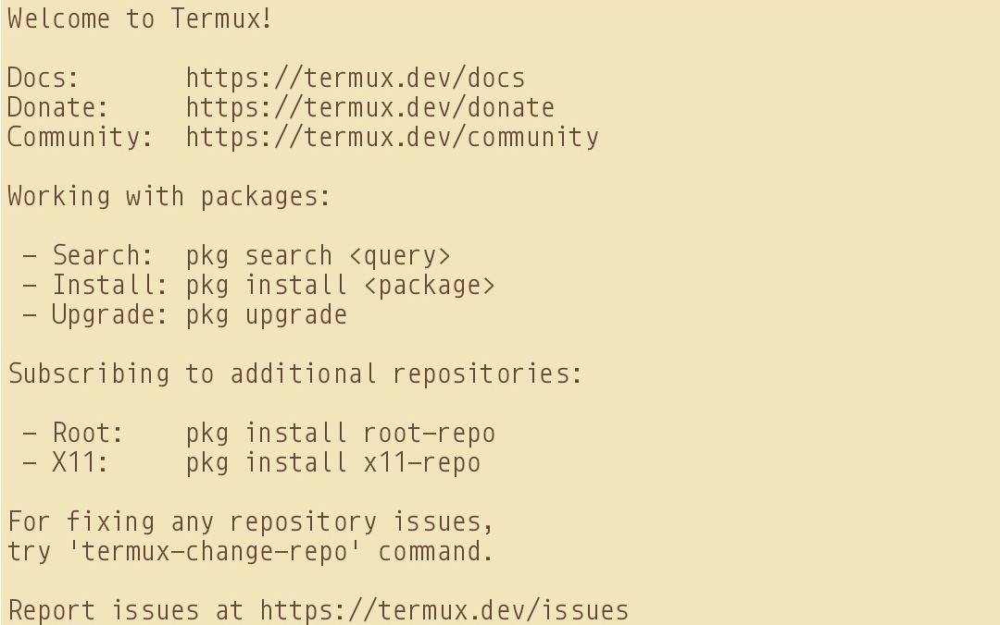
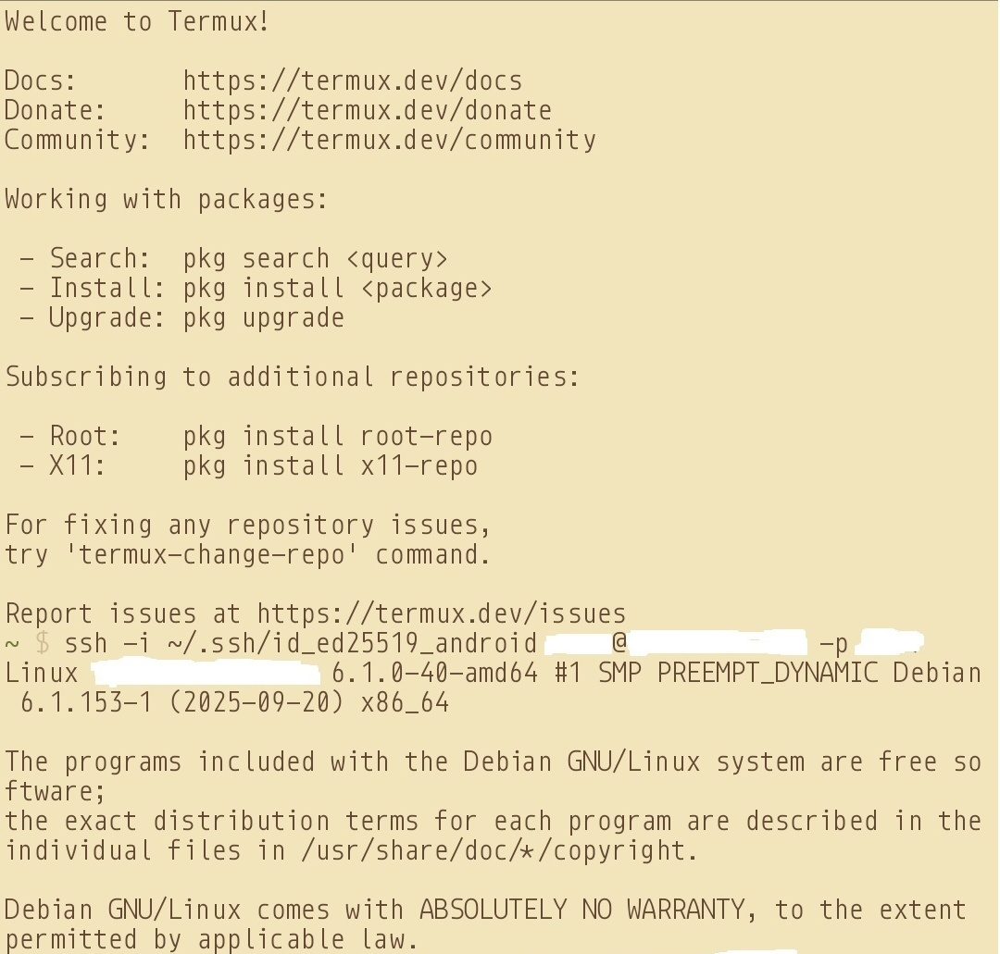
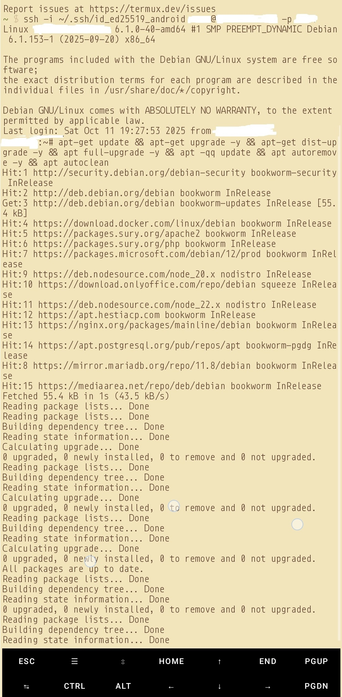

# Introduction

In this tutorial, I will guide you through the process of accessing your root-server from Termux (android terminal application installed via F-Droid) on an android phone.

The reading time of this tutorial is about 30 minutes; implementation will take approximately 90 minutes. The tutorial is for intermediate to advanced users only.

# Background

Termux is a powerful terminal emulator for Android that gives you access to a Linux environment right on your smartphone. With it, you can:

- Run Linux commands
- Control remote servers using SSH
- Install tools like Nmap, Metasploit, or Hydra
- Learn ethical hacking and cybersecurity
- Code in Python, Bash, C, and more
- Root access not required

# Prerequisites

- A Root Server from netcup with latest Ubuntu 20.04/22.04 (LTS); Debian 11/12 or later installed
- Root access to your server
- Android phone with Android version between 5 - 12; CPU: AArch64, ARM, i686, x86_64; at least 300 MB of disk space.
- Basic and above knowledge of using terminal
- Termux already [installed via F-Droid](https://wiki.termux.dev/wiki/Installing_from_F-Droid).
- Secure your root server with [this guide](https://community.netcup.com/en/tutorials/first-steps-to-protect-your-linux-server-against-common-attacks).

N.B.: The Play Store version of Termux is [no longer maintained](https://wiki.termux.dev/wiki/Termux_Google_Play)' and doesn’t support the latest packages or repositories.	

Optional: You may also like to install [termux addons](https://wiki.termux.dev/wiki/Termux:API) & [termux styling](https://f-droid.org/en/packages/com.termux.styling)'

# Step 1: Update your termux packages

Before we begin, it's essential to ensure that your termux pacakges & system are up-to-date. 

Open Termux and update packages Run this command:

```
pkg update -y && pkg upgrade -y
```

Note: If you are looking for a easy guide to install & setup basics of Termux, check [this guide](https://docs.nexoscreator.tech/termux-os/termux-app/installation/).



# Step 2: Install SSH server

Next install openssh, which is required to start the SSH server.

```
pkg install openssh -y
```

After installing openssh, our SSH host configurations and keys are stored under /data/data/com.termux/files/usr/etc/ssh/

Optional: If you like, you can also add the following additional termux repositories:

```
echo "deb https://grimler.se/termux-packages-24 stable main" > $PREFIX/etc/apt/sources.list
echo "deb https://grimler.se/termux-packages-24 stable main" > $PREFIX/etc/apt/sources.list.d/game.list
echo "deb https://grimler.se/termux-packages-24 stable main" > $PREFIX/etc/apt/sources.list.d/science.list
```


# Step 2: Create SSH Private/Public Key Pair on Android - Termux

In our android device, we need to generate SSH key pair for connecting to SSH server the remote machine (example debian). So, run the following command (this will also name the file as android for easy referencing):

```
ssh-keygen -t ed25519 -f id_ed25519_android
```


This will create the public & private key files in the `~/.ssh` folder (**/data/data/com.termux/files/homes/.ssh**)

# Step 3: Send SSH Public Key to Remote Machine

Run `cat ~/.ssh/id_ed25519_android.pub` from termux which will return the public key for your android device.

It will be something like this:

```
ssh-ed25519 ABCDE1AaaA1aAAA1AAA1AAAAAAAAAaaaA1AaaAaaaAaaa1aAAAAaaAAAAaAaaaAAaaAA user@host
```


Now copy and paste this key to your remote machine either via the chat box option in the file transfer assistant app [PlainApp](https://f-droid.org/en/packages/com.ismartcoding.plain/) or copying the `id_ed25519_android.pub` file across to your remote machine (using a USB connection) and then copy the content to `~/.ssh/authorized_keys` file (`$HOME/.ssh/authorized_keys`).

# Step 4: Restart SSHD service on android

Kill/end any running `sshd` service by typing in termux: `pkill -9 sshd`. This is to let go of any cache or broken service pipes.

Now rerun `sshd` command to start the SSH server.

# Step 5: Connect to your remote server

Connect to your remote server using the private key as pairing for the public key, via:

```
ssh -i ~/.ssh/id_ed25519_android user@host -p 1234
```



Optional: Run some command to check everything works as intended. Example:



## Guidance and reverse idealogies

[Termux Wiki](https://wiki.termux.com/wiki/Remote_Access) | [Termux Repos](https://grimler.se/termux/) | [Reverse Logic From](https://exploit-notes.hdks.org/exploit/mobile/android/connect-to-android-from-pc/)

# Conclusion

Now you have a secure connection to your server from your android phone, and with lesser reliability on a laptop/desktop.

# Licence

[MIT](https://github.com/netcup-community/community-tutorials/blob/main/LICENSE)

Copyright (c) 2025 netcup

Permission is hereby granted, free of charge, to any person obtaining a copy of this software and associated documentation files (the "Software"), to deal in the Software without restriction, including without limitation the rights to use, copy, modify, merge, publish, distribute, sublicence, and/or sell copies of the Software, and to permit persons to whom the Software is furnished to do so, subject to the following conditions:

The above copyright notice and this permission notice shall be included in all copies or substantial portions of the Software.

THE SOFTWARE IS PROVIDED "AS IS", WITHOUT WARRANTY OF ANY KIND, EXPRESS OR IMPLIED, INCLUDING BUT NOT LIMITED TO THE WARRANTIES OF MERCHANTABILITY, FITNESS FOR A PARTICULAR PURPOSE AND NONINFRINGEMENT. IN NO EVENT SHALL THE AUTHORS OR COPYRIGHT HOLDERS BE LIABLE FOR ANY CLAIM, DAMAGES OR OTHER LIABILITY, WHETHER IN AN ACTION OF CONTRACT, TORT OR OTHERWISE, ARISING FROM, OUT OF OR IN CONNECTION WITH THE SOFTWARE OR THE USE OR OTHER DEALINGS IN THE SOFTWARE.

# Contributor's Certificate of Origin
By making a contribution to this project, I certify that:

 1) The contribution was created in whole or in part by me and I have the right to submit it under the licence indicated in the file; or

 2) The contribution is based upon previous work that, to the best of my knowledge, is covered under an appropriate licence and I have the right under that licence to submit that work with modifications, whether created in whole or in part by me, under the same licence (unless I am permitted to submit under a different licence), as indicated in the file; or

 3) The contribution was provided directly to me by some other person who certified (a), (b) or (c) and I have not modified it.

 4) I understand and agree that this project and the contribution are public and that a record of the contribution (including all personal information I submit with it, including my sign-off) is maintained indefinitely and may be redistributed consistent with this project or the licence(s) involved.
